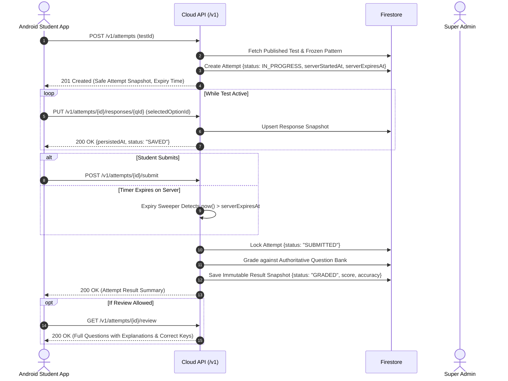

# ClearExam — System Architecture & Trust Boundaries

## 1. System Topology
The system consists of two primary frontend clients interfacing with a single, authoritative backend service backed by Google Cloud & Firebase infrastructure.

```
+------------------------------------+       +------------------------------------+
|         Native Android App         |       |        Super Admin Web App         |
|     (Kotlin + Jetpack Compose)     |       |   (Next.js 15 App Router + Tailwind)|
+------------------+-----------------+       +-----------------+------------------+
                   |                                           |
                   | Firebase ID Token                         | Firebase ID Token
                   | HTTPS REST /v1                            | HTTPS REST /v1
                   v                                           v
+---------------------------------------------------------------------------------+
|                               Shared Cloud API                                  |
|               (Node.js + Express + TypeScript on Cloud Run)                     |
|                                                                                 |
|  - Request ID & Logging (Pino)          - Central Error Handler (RFC 7807)      |
|  - Firebase Token Verification Guard    - Role-Based Access Control (RBAC)      |
|  - OpenAPI Contract Enforcement (Zod)   - Authoritative Exam Engine & Grading   |
+----------------------------------------+----------------------------------------+
                                         |
               +-------------------------+-------------------------+
               |                                                   |
               v                                                   v
+-------------------------------+               +---------------------------------+
|      Firebase Authentication  |               |       Google Cloud Firestore    |
|   (Identity, Claims, Phone)   |               |   (Catalog, Attempts, Answers)  |
+-------------------------------+               +---------------------------------+
```

---

## 2. Server Trust Boundaries & Security Enclaves
1. **Student Question Payload**:
   When a student requests test questions via `GET /v1/attempts/{id}/questions`, the response includes:
   - Question ID, Section ID, Order index
   - Rich text content, Math/LaTeX string, Diagram image URLs
   - Available options (A, B, C, D) with unique option IDs
   **Explicitly Excluded**:
   - `correctOptionId`, `correctOptionIds`, `numericalAnswerValue`
   - `explanation`, `solutionWalkthrough`
   These fields are stripped server-side and never exist in public Firestore documents readable by students.

2. **Server-Authoritative Test Lifecycle**:


---

## 3. Technology Stack & Pinned Rationale
| Layer | Technology | Rationale |
|---|---|---|
| **Android Student App** | Kotlin 2.0+, Jetpack Compose, Material 3, Coroutines, Room | Native performance, fluid animations, offline-first sync, deep integration with Google Play ecosystem. |
| **Admin Web Portal** | Next.js 15, React 19, TypeScript, Tailwind CSS, Lucide | Rapid SSR/SSG admin development, accessible UI components, zero layout lag. |
| **Shared Contracts** | `@clearexam/contracts` (TypeScript + Zod) | Single source of truth for DTOs, request payloads, error envelopes, and design tokens across backend and admin. |
| **Backend API** | Node.js 20+, Express, TypeScript, Firebase Admin SDK | Lightweight, ultra-fast cold start on Cloud Run, direct access to Firestore and Auth Admin APIs. |
| **Database & Auth** | Google Cloud Firestore + Firebase Authentication | Serverless scaling, low latency document storage, phone OTP and Google sign-in support out of the box. |
| **Local Development** | Firebase Emulator Suite (Auth, Firestore, Storage) | Completely offline development without incurring cloud costs or requiring live production keys. |
